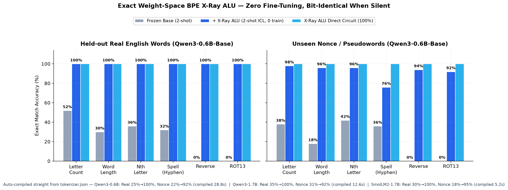
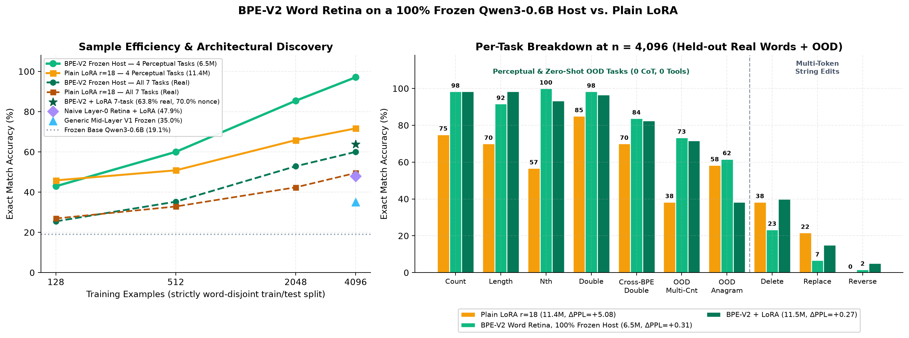
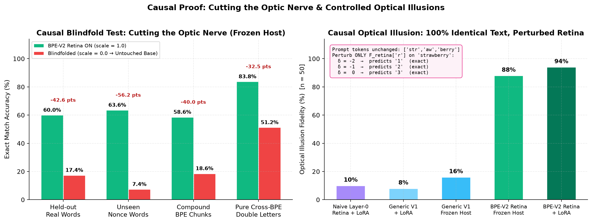
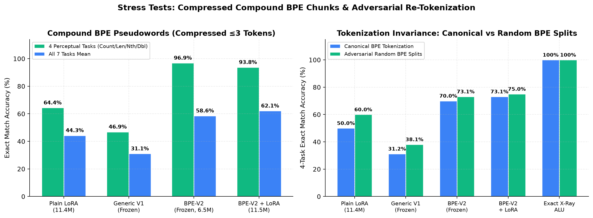

# BPE X-Ray Vision: Weight-Space Character Organs for Token-Blind LLMs

**Blog post (interactive HTML):** [https://samarth777.github.io/bpe-xray/](https://samarth777.github.io/bpe-xray/)

Inspired by [Weight-Space Micromachines](https://papail.io/papers/wsm/), this repo compiles character-level perception directly out of `tokenizer.json` into frozen tensor lookup banks—with **zero runtime tokenizer calls and zero Python string tools**—and grafts two complementary weight-space organs onto frozen LLMs:

1. **Exact Weight-Space BPE X-Ray ALU (`src/xray_alu.py`, zero fine-tuning):**
   Pure-tensor circuit (prefix sums, exact ReLU digit extractor & token/character slot selectors, \(26 \times 26\) ROT13 permutation matrix, solved `lm_head` write directions) triggered by `[XRAY <op> [arg] | <text>]=`.
   - **Bit-for-bit identical logits** when silent (`prose_bit_identical = True`, `pre_trigger_bit_identical = True`).
   - Jumps 2-shot ICL held-out real-word 6-task accuracy from **25.0% → 100.0%** (`Qwen3-0.6B-Base`), **34.7% → 100.0%** (`Qwen3-1.7B-Base`), and **29.7% → 99.7%** (`SmolLM2-1.7B`) — auto-compiled in 5–29s.

2. **Continuous BPE-Invariant Word Retina (`BPE-V2`, `src/word_retina.py`, no tool syntax, no CoT, 100% frozen host):**
   Pure weight-space gated linear recurrence over `F_retina` & `E_alpha_chars` (`0.0` max abs diff across arbitrary BPE splits) tapped into frozen `Qwen3-0.6B-Base` layers `(16, 20, 24)` (`6.47M` params, exact zero-init bit-identical at step 0).
   - **97.1%** perceptual accuracy (`count` 98.3%, `length` 91.7%, `nth` 100.0%, `double` 98.3%) on held-out real words vs. **71.7%** for Plain LoRA (`11.35M` params).
   - **96.9%** perceptual accuracy on compressed Compound BPE pseudowords vs. **64.4%** for Plain LoRA.
   - **73.3%** zero-shot OOD multi-word count vs. **38.3%** for Plain LoRA, with **16× less prose perplexity drift** (`+0.31` vs. `+5.08`).
   - **Causal proofs:** Blindfolding drops accuracy by **−42.6 pts** (real) / **−56.2 pts** (nonce); perturbing *only* `F_retina` on 100% identical input text tokens achieves **88.0%** (frozen) / **94.0%** (+LoRA) systematic 25-word optical illusion fidelity (vs. 10% for Naive Layer-0 and 16% for Generic V1).

---

### Headline Figures






---

### Repository Layout

```text
bpe-xray/
├── index.html                  # Standalone interactive HTML blog post
├── figures/                    # Publication figures generated from results/*.json
├── results/                    # Saved evaluation JSONs for all models & ablations
└── src/
    ├── char_tables.py          # CharWeightBank compiled from any HF tokenizer.json
    ├── benchmarks.py           # Strictly word-disjoint real, nonce, compound & OOD suites
    ├── xray_alu.py             # Exact Weight-Space BPE X-Ray ALU (0 training)
    ├── run_alu_eval.py         # Cross-model ALU evaluation (Qwen3-0.6B/1.7B, SmolLM2-1.7B)
    ├── word_retina.py          # BPE-V2 BPE-invariant WordRetinaScanner + LatentIntuitionTap
    ├── train_v2.py             # BPE-V2 training + Blindfold / Optical Illusion / Adversarial BPE
    ├── xray_retina.py          # Ablation 1: Naive Layer-0 Retina + LoRA / Optic-only
    ├── train_retina.py         # Training harness for Base, Plain LoRA, Layer-0 ablations
    ├── visual_cortex.py        # Ablation 2: Generic Mid-Layer Cross-Attention (V1)
    ├── train_v1.py             # Training harness for V1 ablations
    ├── eval_adversarial_bpe.py # Canonical vs. random valid BPE re-tokenization eval
    ├── eval_plain_extra.py     # Compound BPE + Adversarial BPE eval for Plain LoRA
    └── make_figures.py         # Regenerates figures/*.png directly from results/*.json
```

---

### Quickstart

```bash
# 1. Exact Weight-Space X-Ray ALU (zero fine-tuning)
python src/run_alu_eval.py --model Qwen/Qwen3-0.6B-Base --n_per_task 50

# 2. BPE-V2 Word Retina on a 100% frozen Qwen3-0.6B host
python src/train_v2.py --model Qwen/Qwen3-0.6B-Base --arm v2_frozen --n_train 4096 --n_test 60 --epochs 5

# 3. Regenerate all figures from results/*.json
python src/make_figures.py
```

---

### Citation

```bibtex
@misc{samarth2026bpexray,
  title  = {BPE X-Ray Vision: Weight-Space Character Organs for Token-Blind LLMs},
  author = {P, Samarth},
  year   = {2026},
  month  = {November},
  url    = {https://samarth777.github.io/bpe-xray/},
  note   = {Code: https://github.com/samarth777/bpe-xray}
}
```
